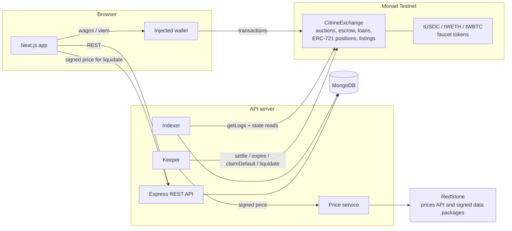

<div align="center">


### Citrine

**Building intelligent solutions with precision.**

</div>
Citrine is a credit exchange on Monad. Borrowers lock collateral and post a loan request with the highest rate they would pay. Lenders compete in an onchain auction to fund it, bidding the rate down. The winning loan is minted as an NFT position that the lender can sell to someone else before it matures.

Built for the Metropolis Hackathon, Track 01: Onchain Finance & Trading.

- **Network:** Monad Testnet (chain id 10143)
- **Exchange contract:** [`0x3a4eBbA0b4944661C1428D84A37730b7a4119569`](https://testnet.monadexplorer.com/address/0x3a4eBbA0b4944661C1428D84A37730b7a4119569)
- **Live app:** _add the published URL here_
- **Demo video:** _add the video link here_

## The problem

Most onchain lending runs through pools. A pool sets one floating rate for everyone from a utilisation curve, so the price of a loan has nothing to do with its term, its collateral, or how much lenders actually want it. Borrowers can't lock in a fixed rate for a fixed term. Lenders can't choose which loans to fund or at what price, and the only way out of a position is to wait for pool liquidity.

Citrine prices each loan on its own. Every request gets an open auction, so the rate is whatever lenders are willing to accept for that collateral and term. The result is a fixed-rate, fixed-term loan, and the lender's side can be traded.

**Who it is for**

- Borrowers who want fixed-term credit against MON, ETH or BTC at a rate set by competition rather than a formula.
- Lenders who want to pick individual loans and name their own rate.
- Traders who want to buy loan positions, often below face value, from lenders who want to exit early.

## How it works

1. **Request.** A borrower locks collateral (MON, tWETH or tWBTC) in the exchange contract and asks for an amount of tUSDC, a term (5 minutes to 1 year), a maximum APR, and an auction length (1 minute to 7 days).
2. **Auction.** Lenders bid the rate down. Each bid must beat the current best by at least 0.05% APR. The winning bidder's tUSDC is held in escrow by the contract, and the lender who was outbid is refunded in the same transaction. A bid in the last 60 seconds extends the auction to 60 seconds from that bid, so sniping doesn't work.
3. **Funding.** The borrower can accept the best bid at any time. Otherwise anyone can settle the auction once it ends. Requests with no bids expire and the collateral goes back to the borrower. Funding sends the tUSDC to the borrower in the same transaction.
4. **Position.** The lender receives an ERC-721 position. Its artwork and terms are generated onchain by `tokenURI`. Whoever holds the position receives the repayment.
5. **Secondary market.** A holder can list the position at a fixed tUSDC price. A buyer pays the seller and takes over the right to be repaid. The Trade page shows each listing's yield to maturity.
6. **Repayment.** Interest is simple interest, accrued per second. The borrower can repay at any time and pays only for the time the loan was open. The collateral is released in the same transaction.
7. **Default.** If the loan is not repaid by maturity plus a grace period (10% of the term, at most 1 day), anyone can claim the default. The collateral goes to the holder, and the caller gets a 0.5% bounty.
8. **Liquidation.** If the debt reaches 85% of the collateral's value, anyone can liquidate the loan. The liquidator attaches a RedStone price signed by three independent RedStone nodes to the transaction. The contract checks the signatures, uses the median, and rejects prices older than 120 seconds. The holder receives collateral worth the debt plus a 5% penalty. The liquidator gets a 0.5% bounty out of that, and the rest goes back to the borrower.

Settling auctions, expiring requests, claiming defaults and liquidating are all permissionless. The backend runs a keeper that calls them automatically, so nothing depends on a person pressing a button.

## Why Monad

- **Fast blocks make short auctions practical.** With sub-second blocks, a one-minute auction and its 60-second anti-sniping window behave as designed, and bids, accepts and repayments confirm almost immediately.
- **Every bid is a real transfer.** Escrowing the new bid and refunding the previous one is a token transfer on every bid. This only works if transactions are cheap and confirm quickly.
- **Full EVM compatibility.** The contracts are standard Solidity built on OpenZeppelin. The frontend uses wagmi and viem with any injected wallet.
- **Signed prices travel with the transaction.** RedStone's pull model needs no oracle contract that someone keeps updating. A liquidation carries its own signed price in calldata, and on Monad the extra calldata and three signature checks cost very little. RedStone also publishes a MON/USD feed, so native MON works as collateral.

## Architecture



- **Contracts (`lib/contracts`).** `CitrineExchange` holds all collateral and escrowed funds. It runs the auctions, tracks loans, mints and burns the position NFTs, and runs the fixed-price secondary market. `PositionArt` renders each position's SVG onchain. `FaucetToken` is the rate-limited test token used for tUSDC, tWETH and tWBTC.
- **Indexer.** Reads exchange events in 100-block ranges, up to a few blocks behind Monad's finalized block. After each batch, it re-reads the affected requests and loans from the contract at that batch's block, so the stored state always matches the chain. Once a minute it re-reads every open request and active loan to catch any missed update.
- **Keeper.** Settles ended auctions, expires requests with no bids, claims defaults and liquidates unhealthy loans. It simulates every call first and only sends transactions that will succeed.
- **Prices.** The exchange inherits RedStone's `PrimaryProdDataServiceConsumerBase`. A liquidation appends a RedStone payload to the `liquidate` calldata; the contract recovers each signer, requires three distinct nodes from the `redstone-primary-prod` service, and takes the median. The API's price service reads display prices for MON, ETH and BTC from RedStone's prices API every 10 seconds, and fetches signed data packages from RedStone's gateways only when the keeper or a user's wallet needs one. No API key is needed.
- **One writer at a time.** If more than one API instance runs, they elect a leader through an expiring lease in MongoDB. Only the leader indexes and sends keeper transactions; the others serve reads. The leader checks the lease again after every chain read and right before every write or broadcast, and the stored block cursor only moves forward.
- **API.** A read model over MongoDB: market stats, auctions, loans, listings, the rate curve, activity, and per-wallet portfolios. It also handles guest sessions and wallet linking. The API never holds user funds or user keys. All money moves through users' own wallets.
- **Guest identity.** There is no sign-up and no password. A visitor picks a username and gets a guest session stored on their device. They can link a wallet by signing a message, and their name then appears next to their bids and loans. Entering a name that already exists offers to continue as that guest. If the guest has a linked wallet, continuing needs a fresh signature from that wallet, and linking a wallet signs the guest out on other devices, so the wallet is what protects the name.
- **Frontend (`artifacts/citrine`).** Next.js App Router. Data refreshes continuously from the API. Transactions go through wagmi, with approvals, chain switching and receipt tracking handled in the UI.

## Contract addresses (Monad Testnet)

| Contract | Address |
| --- | --- |
| CitrineExchange (also the ERC-721 position contract) | [`0x3a4eBbA0b4944661C1428D84A37730b7a4119569`](https://testnet.monadexplorer.com/address/0x3a4eBbA0b4944661C1428D84A37730b7a4119569) |
| tUSDC (loan asset, 6 decimals) | [`0x4559De5D1052f5d95635355273839BB42BB4d2D6`](https://testnet.monadexplorer.com/address/0x4559De5D1052f5d95635355273839BB42BB4d2D6) |
| tWETH (collateral, 18 decimals) | [`0xf00735aaf54fF0Aeed45dFdbA18D57D38840aAb3`](https://testnet.monadexplorer.com/address/0xf00735aaf54fF0Aeed45dFdbA18D57D38840aAb3) |
| tWBTC (collateral, 8 decimals) | [`0x9FD4372692B873B94088c9Ac831cDC27769744b6`](https://testnet.monadexplorer.com/address/0x9FD4372692B873B94088c9Ac831cDC27769744b6) |

MON is accepted as native collateral. Prices come from RedStone's `redstone-primary-prod` data service (MON, ETH and BTC feeds), verified inside the exchange, so there is no separate oracle contract address. The exchange was deployed at block 67463993 (transaction [`0xd49c6961…`](https://testnet.monadexplorer.com/tx/0xd49c69615d4dcd00aab334cade66f2b2f9099e3fa92275a470acfa5f4b7865a9)), and all four contracts are verified through Sourcify. The full deployment record is in `lib/contracts/src/deployments.ts`.

### Protocol parameters

| Parameter | Value |
| --- | --- |
| Loan term | 5 minutes to 1 year |
| Auction length | 1 minute to 7 days |
| Minimum bid improvement | 0.05% APR |
| Anti-sniping extension | 60 seconds |
| Maximum APR | 100% |
| Grace period | 10% of the term, capped at 1 day |
| Liquidation threshold | 85% loan-to-value |
| Liquidation penalty | 5% of debt |
| Liquidator / default-claim bounty | 0.5% |
| Maximum price age for liquidation | 120 seconds |

## Technology stack

- **Contracts:** Solidity 0.8.28, Hardhat, OpenZeppelin Contracts 5, RedStone EVM connector
- **Backend:** Node.js 24, Express 5, MongoDB Node driver 6, viem, RedStone SDK, Zod, pino
- **Frontend:** Next.js 16 (App Router, Turbopack), React 19, wagmi 2 and viem, TanStack Query, Tailwind CSS, Radix UI (shadcn/ui), Framer Motion, Recharts, lucide-react
- **Tooling:** pnpm workspaces, TypeScript 5.9, Orval (OpenAPI to React Query hooks and Zod schemas), esbuild

## Repository layout

```
artifacts/citrine        Next.js frontend
artifacts/api-server     Express API, indexer, keeper and price service
lib/contracts            Solidity contracts, tests, deploy/verify/seed scripts, ABIs and deployment addresses
lib/api-spec             OpenAPI spec, the source of truth for the API
lib/api-client-react     Generated React Query hooks used by the frontend
lib/api-zod              Generated Zod schemas used by the API
lib/db                   MongoDB collections, document types and indexes
```

## Running it yourself

**Prerequisites**

- Node.js 24 and pnpm 10
- A MongoDB database (a free MongoDB Atlas cluster works)
- A Monad testnet wallet with some MON for gas ([Monad faucet](https://faucet.monad.xyz))

**1. Install**

```bash
pnpm install
```

**2. Configure the API server**

| Variable | Required | Purpose |
| --- | --- | --- |
| `MONGODB_URI` | yes | MongoDB connection string |
| `MONGODB_DB` | no | Database name (default `citrine`) |
| `DEPLOYER_PRIVATE_KEY` | for deploying and the keeper | Deploys contracts. The keeper also uses it unless `KEEPER_PRIVATE_KEY` is set |
| `KEEPER_PRIVATE_KEY` | no | Separate key for the keeper |
| `KEEPER_ENABLED` | no | Set to `false` to turn the keeper off |
| `REDSTONE_PRICES_URL` | no | RedStone prices API for display prices (default `https://api.redstone.finance/prices`). No key needed |
| `MONAD_RPC_URL` | no | RPC endpoint (default `https://testnet-rpc.monad.xyz`) |
| `PORT` | yes | Port for the API server |

**3. Run the API and the app**

```bash
PORT=8080 pnpm --filter @workspace/api-server run dev
PORT=3000 API_PROXY_TARGET=http://localhost:8080 pnpm --filter @workspace/citrine run dev
```

Open http://localhost:3000. The app calls the API on relative `/api` paths. Locally, `API_PROXY_TARGET` makes Next.js forward those requests to the API server. On Replit, a path router does this, so the variable is not needed there.

In the app, pick a username, connect an injected wallet (MetaMask, Rabby or similar), switch to Monad Testnet when prompted, and use **Faucet** to mint tUSDC, tWETH and tWBTC.

**4. Contracts (optional, to deploy your own copy)**

```bash
pnpm --filter @workspace/contracts run compile
pnpm --filter @workspace/contracts run test            # Hardhat test suite
pnpm --filter @workspace/contracts run deploy:testnet  # writes lib/contracts/src/deployments.ts
pnpm --filter @workspace/contracts run verify:testnet
pnpm --filter @workspace/contracts run seed:testnet    # optional demo activity, see below
```

The deploy script deploys the three faucet tokens and the exchange, then records the addresses and start block in `lib/contracts/src/deployments.ts`. The API and frontend read that file. After a redeploy, the indexer detects the new exchange address and rebuilds its index from the new start block.

**Deploying on Replit.** The web app builds with `next build` and runs with `next start`. The API server is bundled with esbuild. Use a Reserved VM deployment, because the indexer and keeper need to run continuously.

## Testnet demo data

To make the market active from the first visit, the testnet exchange was seeded with `lib/contracts/scripts/seed.cjs`. It sends real transactions from four team-controlled wallets: several auctions that settled into loans, a repayment, a default claimed by the keeper, a loan opened at about 90% LTV that the keeper liquidated with a signed RedStone price, two secondary listings (one of them sold), and a few live auctions. These wallets are not linked to any usernames. All other activity comes from real users.

## AI tools disclosure

This project was built with AI assistance. Replit Agent, an AI coding agent, wrote most of the code in this repository, including the contracts, tests, backend, frontend and this README. It worked from the team's product requirements, and the team directed the design, reviewed the results and tested the product on Monad testnet.

## Pre-existing code and attribution

The repository started from Replit's pnpm monorepo template. The template provided the workspace layout, an Express server skeleton, the OpenAPI/Orval code generation setup, and the stock shadcn/ui components in `artifacts/citrine/src/components/ui`. The protocol, contracts, indexer, keeper, API routes and application UI were built during the hackathon.

Third-party code used, under its own license:

- [OpenZeppelin Contracts](https://github.com/OpenZeppelin/openzeppelin-contracts) (MIT): ERC-721, SafeERC20, ReentrancyGuard and math utilities
- [RedStone Oracles](https://github.com/redstone-finance/redstone-oracles-monorepo): `@redstone-finance/evm-connector` (the consumer contracts the exchange inherits to verify signed prices), `@redstone-finance/sdk` (fetches signed data packages in the API) and `@redstone-finance/protocol` (signs mock packages in the tests). Their package metadata says MIT, but each package ships the Business Source License 1.1 from Distributed Data Labs, and the core consumer contracts compiled into `CitrineExchange` carry BUSL-1.1 headers. The helper libraries and mock signers used from the connector are MIT. BUSL-1.1 allows non-production use, which covers this testnet deployment; a mainnet launch would need RedStone's permission. The packages are installed from npm, not copied into this repository.
- [shadcn/ui](https://ui.shadcn.com) (MIT) and [Radix UI](https://www.radix-ui.com) (MIT): UI primitives
- [Next.js](https://nextjs.org), [React](https://react.dev), [wagmi](https://wagmi.sh), [viem](https://viem.sh), [TanStack Query](https://tanstack.com/query), [Express](https://expressjs.com), [Framer Motion](https://www.framer.com/motion), [Recharts](https://recharts.org), [lucide](https://lucide.dev) (MIT)
- [MongoDB Node.js driver](https://github.com/mongodb/node-mongodb-native) (Apache-2.0)
- Fonts: Bricolage Grotesque, Geist and Geist Mono (SIL Open Font License), loaded through `next/font`

## License

Citrine's own code is released under the [MIT License](LICENSE). Third-party packages keep their own licenses, listed above.
